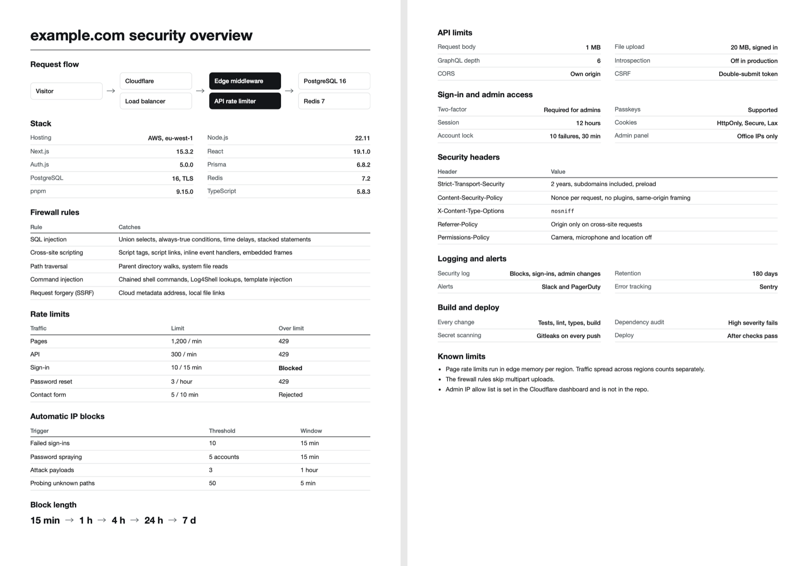

# Website security report

An agent skill that reads a site's code and renders a PDF of the security
controls it enforces, with every number traced to a line of code.



## Install

```bash
git clone https://github.com/nmbrthirteen/website-security-report.git ~/.claude/skills/website-security-report
```

Then ask for a security overview, or run `/website-security-report`. Needs
Node 18+ and Chrome.

MIT license.
